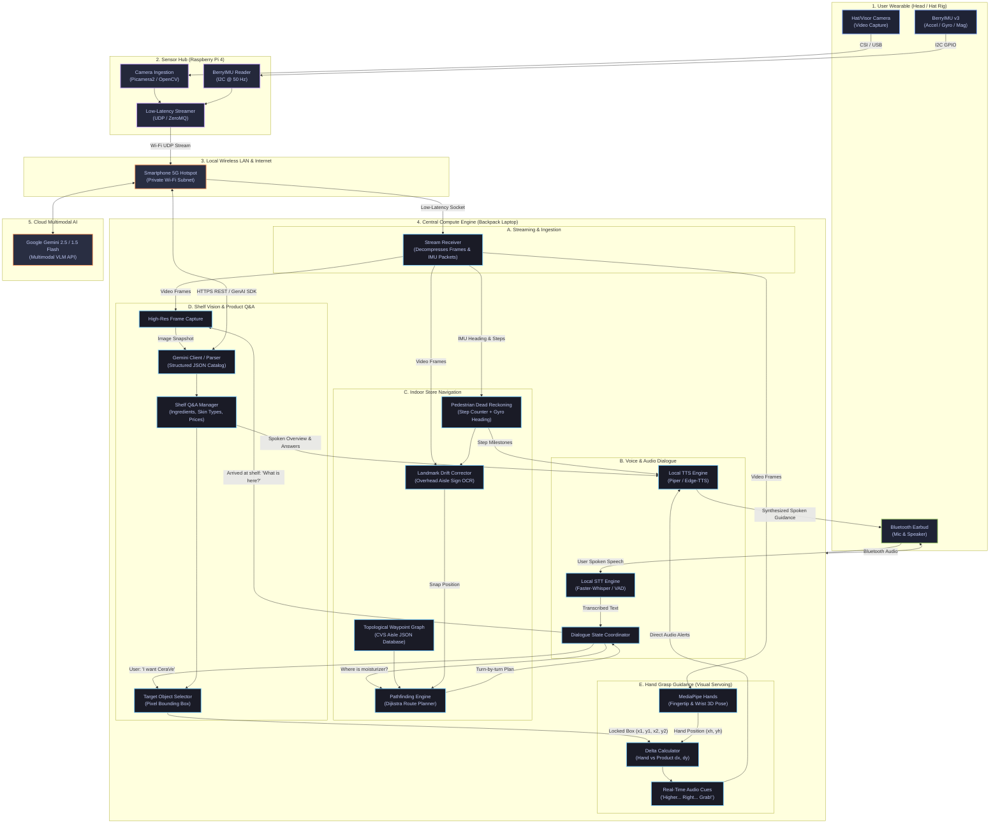

# System Block Diagram — Assistive Shopping Assistant

This document visualizes the complete end-to-end hardware and software architecture for **ECE 180DA Team 4**.

---

## 1. Complete System Block Diagram

---

## 2. Subsystem Interface Summary

| Subsystem | Input Source | Processing Engine | Output / Destination |
|---|---|---|---|
| **Sensor Hub (RPi 4)** | Camera (CSI/USB), BerryIMU (I2C) | Lightweight OpenCV + SMBus | UDP/ZeroMQ packet stream to Laptop over Wi-Fi |
| **Voice Interface** | Bluetooth Earbud Microphone | Faster-Whisper (STT) + Piper (TTS) | Text commands to Dialogue Coordinator; Spoken audio to earbud |
| **Indoor Navigation** | Pre-mapped CVS JSON, IMU steps & gyro, camera frames | Dijkstra Shortest Path + OCR Landmark Resets | Turn-by-turn walking instructions (*"Walk 8 steps... turn left into Aisle 4"*) |
| **Shelf Multimodal Q&A** | 1280x800 camera snapshot, user voice queries | Google Gemini 2.5/1.5 Flash API | Spoken product summary, interactive answers, product bounding boxes `[ymin, xmin, ymax, xmax]` |
| **Hand Guidance (Servoing)**| Live camera feed + locked target bounding box | MediaPipe Hands (`hand_landmarker.task`) + offset delta | Rapid verbal guidance cues (*"Move right... down... reach forward... grab it!"*) |
